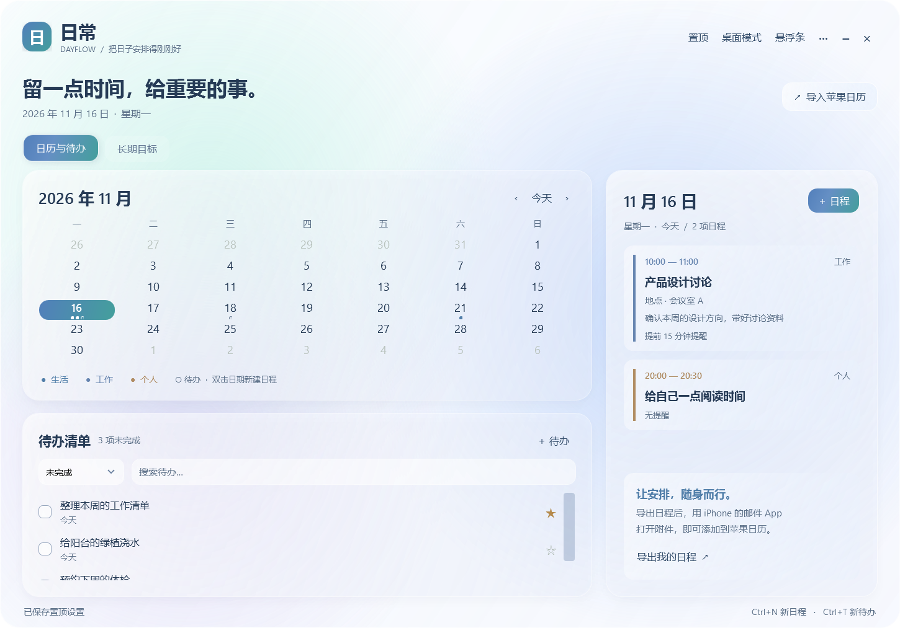
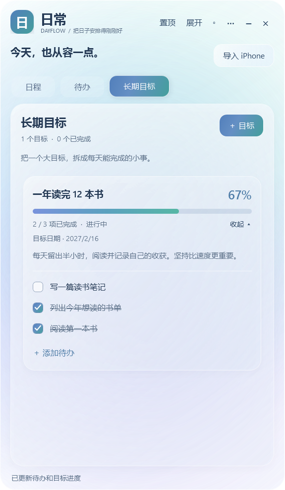

# 日常 DayFlow

轻量的 Windows 桌面日历、待办与长期目标工具。透明毛玻璃与柔和渐变界面，支持极简悬浮条、本地保存，以及导出到 iPhone 日历。

[下载 Windows 版](https://github.com/banyu2000/dayflow-desktop/releases/latest) · [使用说明](docs/USER_GUIDE.zh-CN.txt) · [更新记录](CHANGELOG.md) · [MIT 许可证](LICENSE)



## 功能

- **日历与日程**：月历、当天安排、跨天与全天日程、分类、地点、备注和运行期间的桌面提醒。
- **待办**：截止日期、重要标记、搜索、筛选、完成与恢复，操作后自动保存。
- **长期目标**：一个目标包含多项待办，自动计算完成数、百分比和进度条。
- **极简悬浮条**：每个圆点对应一项今天的待办；暗点未完成，亮点已完成。悬停查看标题，点击切换状态。支持拖动、记住位置、换行与滚动。
- **开机自启动**：可选，在当前 Windows 用户的“启动”文件夹创建快捷方式，恢复上次显示模式。
- **透明界面**：Glassmorphism + Modern Gradient；150–280ms 的局部交互反馈，缓动为 `cubic-bezier(.22,1,.36,1)`。
- **导入苹果日历**：导出 `.ics`，在 iPhone 系统“邮件”App 中打开附件并添加到日历。
- **本地数据**：无需账号，支持 JSON 备份、恢复、上一次保存版本及旧版数据迁移。


<details>
<summary>查看长期目标界面</summary>



</details>

## 下载安装

1. 从 [Releases](https://github.com/banyu2000/dayflow-desktop/releases) 下载 `DayFlow-v1.3.0-windows.zip`。
2. 提取全部文件到有写入权限的固定目录，再双击 `日常日历.exe`。
3. 顶部“悬浮条”进入极简模式；点 `↗` 展开；`··· → 开机自启动` 可切换登录后自启动。

适用于 **Windows 10 / 11 + .NET Framework 4.8**。运行不需要 Python、Node.js 或管理员权限。
Windows 11 22H2 及以上优先使用 Desktop Acrylic，Windows 10 有兼容路径；效果受系统透明设置影响。

已有用户升级时，先退出旧程序，再替换 exe 和图标，**保留原来的 `data` 文件夹**。
移动程序文件夹后，请在新位置重新开启自启动。

## 从源码构建

在 Windows PowerShell 中运行（使用系统 .NET Framework C# 编译器）：

```powershell
powershell -NoProfile -ExecutionPolicy Bypass -File .\build.ps1
```

结果位于 `build/日常日历.exe`。无需 NuGet 包；源码为 C# / WPF，主题以资源形式嵌入。
源码不包含本机日程、待办、启动快捷方式或用户设置。

```powershell
# 数据、兼容性与基本 WPF 构造检查
powershell -NoProfile -ExecutionPolicy Bypass -File .\scripts\test.ps1

# 完整 WPF 交互检查；需要可交互的 Windows 桌面
powershell -NoProfile -ExecutionPolicy Bypass -File .\scripts\test.ps1 -Ui

# 生成不含个人数据的便携包
powershell -NoProfile -ExecutionPolicy Bypass -File .\scripts\package.ps1
```

测试输出写入独立的 `test-output` 目录；发布包写入 `dist`。GitHub Actions 自动构建并运行基础自测。
v1.3 在开发机上通过 101 项数据/兼容性断言及 62 项 WPF 交互检查。Windows 10 兼容路径与实体 iPhone 导入尚未实机验证。

## 数据与导入说明

- 数据保存在程序目录下 `data/calendar.json`，未加密；本程序不上传日程，也不使用苹果账号。
- `.ics` 是一次性导入，**不是 iCloud 双向同步**。后续修改需重新导出，避免重复导入同一批日程。
- 有日期的未完成待办可选择导出为全天日程；完成状态、目标及进度不会同步到手机。
- 桌面提醒需要程序持续运行；电脑关机或退出程序后不会提醒。
- PNG 预览为实际 WPF 控件使用示例数据绘制的图层，不包含 Windows 合成器的实时背景模糊。

## 项目结构

```text
src/DayFlow/       C# / WPF 源码、主题、图标和底层构建脚本
docs/             使用说明与示例界面
scripts/          测试和便携包生成
.github/workflows/ Windows 构建与基础自测
```

欢迎通过 [Issues](https://github.com/banyu2000/dayflow-desktop/issues) 反馈问题。请先删除个人日程、待办内容及本机路径，不要直接上传自己的 `calendar.json`。

## License

[MIT](LICENSE) © 2026 banyu2000
